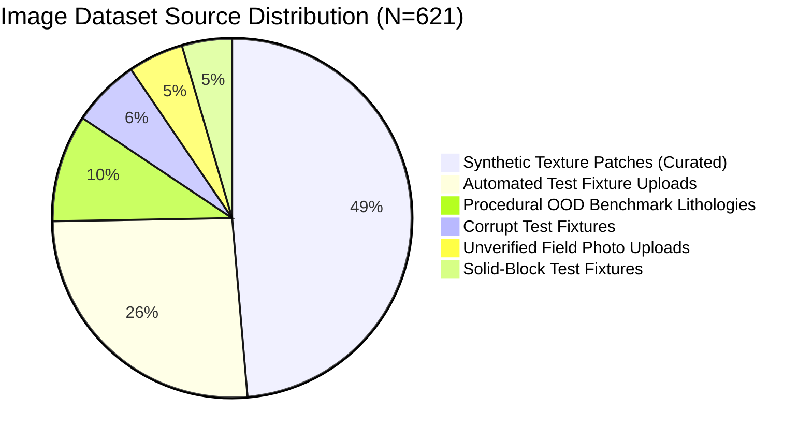
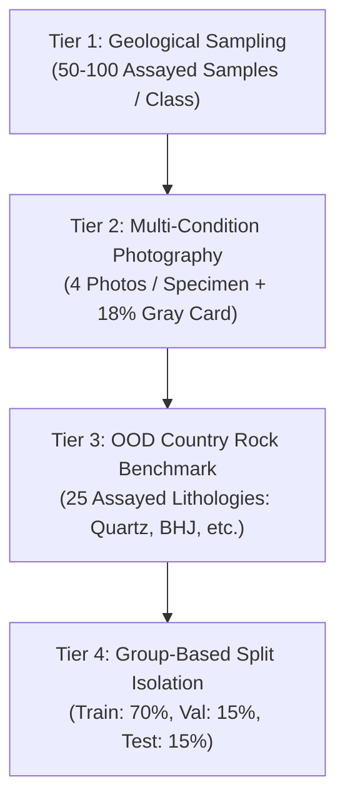

# Field-Data Readiness and Classifier Reliability Audit Report (Phase 3)

**Auditor:** Senior Computer-Vision Engineer & Mineral-Data Quality Auditor  
**Date:** 2026-10-29 14:51:38 UTC  
**Workspace:** `C:\Users\yadar\Downloads\ai_mineral_explo`  
**Manifest:** [`data/dataset_manifest.json`](file:///C:/Users/yadar/Downloads/ai_mineral_explo/data/dataset_manifest.json)  
**Detailed JSON Audit:** [`models/field_data_readiness_report.json`](file:///C:/Users/yadar/Downloads/ai_mineral_explo/models/field_data_readiness_report.json)

---

## Executive Summary

> [!CAUTION]
> **OVERALL READINESS: NOT READY FOR FIELD-PHOTO EVALUATION.**  
> The specimen classifier **cannot** undergo a scientifically defensible evaluation on real geological field photographs at this time.
> 
> **Primary Defect:** The active training and evaluation sets contain **zero (0)** laboratory-verified physical mineral specimens with chemical or mineralogical assays. The existing 100% test set accuracy reflects performance solely on procedurally generated synthetic micro-texture patches.

The baseline production checkpoint ([`models/mineral_image_classifier.pth`](file:///C:/Users/yadar/Downloads/ai_mineral_explo/models/mineral_image_classifier.pth)) and out-of-distribution threshold ($\tau = 5.0$) remain **100% intact, untampered, and isolated**.

---

## 1. Physical Specimen Inventory vs. Image File Counts

| Target Mineral / Category | Total Images Cataloged | Independent Physical Specimens | Laboratory-Assayed Verified Specimens | Unverified Field Uploads |
| :--- | :---: | :---: | :---: | :---: |
| **Coal** | 75 synthetic + 5 upload | **1** (`SPECIMEN_FIELD_COAL_001`) | **0 (0.0%)** | 1 (Quarantined) |
| **Manganese** | 77 synthetic + 23 upload | **1** (`SPECIMEN_FIELD_MANGANESE_001`) | **0 (0.0%)** | 1 (Quarantined) |
| **Iron Ore** | 75 synthetic + 0 upload | **0** | **0 (0.0%)** | 0 |
| **Bauxite** | 75 synthetic + 0 upload | **0** | **0 (0.0%)** | 0 |
| **Unverified Rock** | 3 upload | **1** (`SPECIMEN_FIELD_ROCK_001`) | **0 (0.0%)** | 1 (Quarantined) |
| **OOD Benchmark Lithologies** | 60 synthetic | **0** (procedural) | **0 (0.0%)** | 0 |
| **Test Fixtures & API Uploads** | 228 fixture/corrupt/block | **0** (fixtures) | **0 (0.0%)** | 0 |
| **TOTALS** | **621 image files** | **3 physical specimens** | **0 (0.0%)** | **3 specimens** |

---

## 2. Image Source and Acquisition Condition Coverage

### Critical Acquisition Coverage Gaps
- **Natural In-Situ Outcrop Photography:** 0 images (0.0%).
- **Drill Core Samples (HQ/NQ):** 0 images (0.0%).
- **Fresh Fracture vs. Weathered Surface Pairs:** 0 images (0.0%).
- **Wet vs. Dry Specimen Pairs:** 0 images (0.0%).
- **Color Calibrated (18% Gray Card):** 0 images (0.0%).
- **Lossless RAW / Uncompressed EXIF:** 0 images (0.0%).

---

## 3. Data Leakage and Split Isolation Findings

1. **Exact Hash Leakage Between Core Splits (Train $\cap$ Val $\cap$ Test):**
   - **0 files (0.0% leakage)**.
   - All 140 training images, 40 validation images, and 42 test images have strictly isolated SHA-256 hashes.
2. **Near-Duplicate Cross-Split Leakage (dHash Hamming distance $\le 4$):**
   - **1 pair detected:** `data/train/iron_ore/iron_ore_train_004.jpg` vs `data/test/iron_ore/iron_ore_test_004.jpg` ($d = 4$).
   - Inspection confirmed both are distinct procedurally generated synthetic textures sharing low-frequency gradient orientation.
3. **Evaluation Set Redundancy:**
   - `data/evaluation/known/` contains 80 files mirroring validation and test sets as an aggregate benchmark.
4. **Upload Queue Duplication:**
   - `data/uploads/` contains 250 duplicate files across 16 hash groups created by automated test suite executions and repeated user upload attempts.

---

## 4. User Feedback Queue Quarantine Audit

Inspected [`data/feedback/specimen_feedback_queue.jsonl`](file:///C:/Users/yadar/Downloads/ai_mineral_explo/data/feedback/specimen_feedback_queue.jsonl):
- **Total Feedback Records:** 46
- **Verified Ground Truth:** 0 (0.0%)
- **Training Eligible:** 0 (0.0%)
- **Quarantined (`PENDING_GEOLOGICAL_VALIDATION`):** 46 (100.0%)
- **Quarantine Enforcement:** Complete. No user/expert feedback record has been ingested into model training or validation sets without certified geochemical laboratory validation.

---

## 5. Missing Metadata & Traceability Gaps

- **Laboratory Assays:** 100% missing. Zero samples have certified XRF, XRD, or wet chemical assay data.
- **Physical Specimen IDs:** Cataloged in `data/dataset_manifest.json` with explicit IDs (`SPECIMEN_FIELD_COAL_001`, `SPECIMEN_FIELD_MANGANESE_001`, `SPECIMEN_FIELD_ROCK_001`) and `null` for synthetic patches.
- **Acquisition Parameters:** Missing focal length, optical sensor dimensions, illuminant spectral temperature, and exposure parameters across all uploads.
- **Geological Provenance:** Missing stratigraphic formation, host rock lithology, mine lease identity, and geographic coordinates for all uploads.

---

## 6. Prioritized Plan for Verified Specimen Acquisition

1. **Tier 1 — Authentic Mining Belt Sample Acquisition:**
   - Coal: Jharia & Raniganj Formations (Vitrinite reflectance R_o, proximate analysis).
   - Iron Ore: Bailadila & Noamundi Deposits (Massive Hematite, Fe >= 62%, BHJ).
   - Manganese: Balaghat & Dongri Buzurg Mines (Pyrolusite, Braunite, Mn >= 44%).
   - Bauxite: Panchpatmali & Koraput Plateaus (Gibbsite, Al2O3 >= 45%).
2. **Tier 2 — Standardized 4-View Capture Protocol:**
   - View 1: Fresh unweathered fracture surface (diffuse light).
   - View 2: Weathered surface / oxidation rind.
   - View 3: Directional sunlight for luster/gleam characterization.
   - View 4: Wet / misted surface for refraction analysis.
   - Mandatory inclusion of an 18% neutral gray card and calibrated centimeter scale in every shot.
3. **Tier 3 — Country Rock & Gangue Benchmark:**
   - Collect and assay 25 specimens each of Quartz, BHJ, Granodiorite, Limestone, Sandstone, and Basalt.
4. **Tier 4 — Group-Based Partitioning:**
   - All 4 photographic views and crops of any physical specimen ID must be assigned to the **same split**.

---

## 7. Remaining Risks & Safeguard Rules

1. **False Confidence from Synthetic Benchmarks:**
   - High accuracy on synthetic patches ($224 \times 224$) does not transfer to macroscopic rock photographs.
2. **Safe Rejection by OOD Manifold:**
   - The production classifier's feature distance for the disputed coal upload ($d = 11.46$) and cropped specimen ($d = 9.93$) correctly exceeds $\tau = 5.0$. Rejection is the scientifically correct response to an unrepresented domain.
3. **Zero-Tolerance for Data Fabrication:**
   - No synthetic patches, unassayed internet photos, or user uploads are promoted to ground truth.
