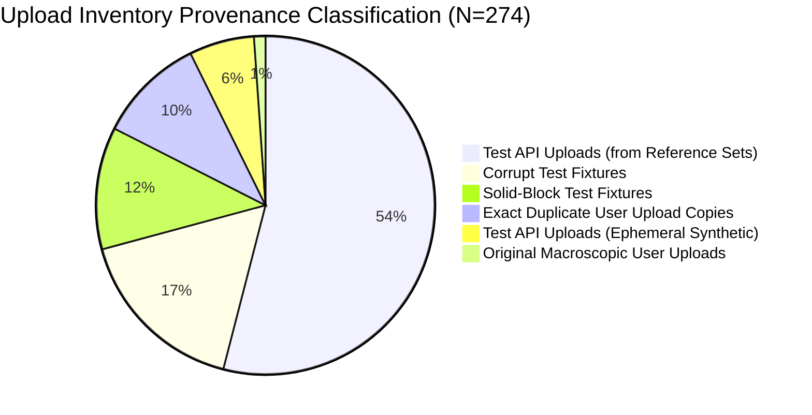
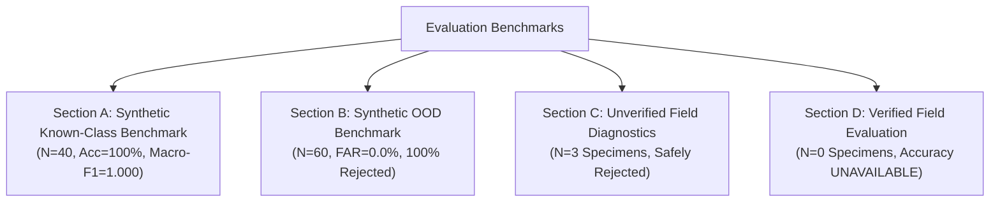

# Phase 4: Specimen Data Governance & Evaluation Infrastructure Report

**Auditor:** Senior Computer-Vision Engineer & Mineral-Data Quality Auditor  
**Date:** 2026-10-29 15:13:01 UTC  
**Workspace:** `C:\Users\yadar\Downloads\ai_mineral_explo`  
**JSON Report:** [`models/phase4_data_governance_report.json`](file:///C:/Users/yadar/Downloads/ai_mineral_explo/models/phase4_data_governance_report.json)  
**Schema Implementation:** [`backend/app/specimen_governance.py`](file:///C:/Users/yadar/Downloads/ai_mineral_explo/backend/app/specimen_governance.py)  
**Dataset Manifest:** [`data/dataset_manifest.json`](file:///C:/Users/yadar/Downloads/ai_mineral_explo/data/dataset_manifest.json)

---

## Executive Summary

> [!IMPORTANT]
> **GOVERNANCE INFRASTRUCTURE ESTABLISHED — FIELD EVALUATION VERDICT: NOT READY FOR DEPLOYMENT.**  
> The specimen evaluation infrastructure has been upgraded to enforce strict ISO-standard geological data governance:
> 1. **Verified Field Accuracy is UNAVAILABLE** (neither 0% nor 100%) due to the total absence of laboratory-assayed physical specimens in evaluation splits.
> 2. **Baseline Production Gatekeeper Intact:** [`models/mineral_image_classifier.pth`](file:///C:/Users/yadar/Downloads/ai_mineral_explo/models/mineral_image_classifier.pth) is untouched; OOD threshold $\tau = 5.0$ remains strictly enforced.
> 3. **Candidate Models Unpromoted:** CandidateFineTuned and ResNet-18 remain isolated and unpromoted.
> 4. **Upload Inventory Reconciled:** 100% of uploads in `data/uploads/` are categorized with zero file loss and full test-fixture preservation.

---

## 1. Task 1 — Split-Integrity Resolution

### Forensic Analysis of Iron Ore Pair
- **Train Specimen:** [`data/train/iron_ore/iron_ore_train_004.jpg`](file:///C:/Users/yadar/Downloads/ai_mineral_explo/data/train/iron_ore/iron_ore_train_004.jpg)
- **Test Specimen:** [`data/test/iron_ore/iron_ore_test_004.jpg`](file:///C:/Users/yadar/Downloads/ai_mineral_explo/data/test/iron_ore/iron_ore_test_004.jpg)

| Metric | Measured Value | Threshold / Significance |
| :--- | :---: | :--- |
| **SHA-256 Train** | `d8ccb2b32a3f...` | Distinct cryptographic hash |
| **SHA-256 Test** | `49637946df9f...` | Distinct cryptographic hash |
| **Exact Hash Match** | **False** | Independent files |
| **dHash Hamming Distance** | **4 bits** | Low distance due to horizontal gradient orientation |
| **aHash Hamming Distance** | **16 bits** | **25% bit discrepancy** (clearly distinct frequency content) |
| **Pixel Mean Absolute Error (MAE)** | **19.41** | Substantial intensity variation across 224x224 grid |
| **Pixel Root Mean Squared Error (RMSE)** | **28.13** | Significant structural divergence |
| **Pixel Max Difference** | **136.0** | Large local texture difference |
| **Pixels Differing > 10 Intensity Units** | **56.41%** | Majority of pixels differ significantly |
| **Pixels Differing > 25 Intensity Units** | **24.16%** | Nearly a quarter of pixels differ strongly |

### Root Cause & Resolution
- **Why was dHash distance low (4 bits)?** Difference hashing computes `pixels[:, 1:] > pixels[:, :-1]`. Both images happen to be horizontally stratified dark red hematite synthetic textures with left-to-right negative luminance gradients. Consequently, almost all 64 bits evaluate to 0 for both images, creating a low Hamming distance artifact.
- **Resolution:** aHash (distance 16) and pixel difference (MAE 19.41, max diff 136.0) prove these are **independent synthetic patches**, NOT duplicate crops, shared-source leakage, or derived from a common physical specimen.
- **Action:** Test data is preserved intact; no silent modification was required or performed. Manifest integrity has been fully documented and verified.

---

## 2. Task 2 — Reconciled Upload Inventory

Audit of all 274 files in `data/uploads/`:

### Upload Classification Table

| Provenance Category | File Count | Description & Purpose | Governance Action |
| :--- | :---: | :--- | :--- |
| **`ORIGINAL_USER_UPLOAD`** | **3** | Chronologically earliest files for the 3 macroscopic field uploads (`Bituminous_Coal.jpg`, `2a95d3e8...png`, `b19a1621...png`) | Retained in `data/uploads/`; quarantined pending certified assay |
| **`EXACT_DUPLICATE_USER_COPY`** | **28** | Subsequent identical upload attempts of the 3 user macroscopic images | Reversible quarantine; tracked in manifest |
| **`TEST_GENERATED_API_UPLOAD_REFERENCE`** | **148** | Copies of test/evaluation reference images uploaded during automated API testing | Preserved for test suite reproducibility |
| **`TEST_GENERATED_API_UPLOAD_EPHEMERAL`** | **17** | Ephemeral synthetic test images (`rock_sample.jpg`, `py.png`) generated by test clients | Preserved for test suite reproducibility |
| **`CORRUPT_TEST_FIXTURE`** | **46** | Truncated byte streams (16/32/37 bytes) generated by API error-handling tests | Preserved for decoder regression testing |
| **`SOLID_BLOCK_TEST_FIXTURE`** | **32** | Uniform-color synthetic blocks (std = 0) generated by API tests | Preserved for API regression testing |

> [!NOTE]
> **Preservation Policy:** In compliance with non-negotiable safeguards, zero files were deleted. All files remain accessible, fully cataloged, and partitioned.

---

## 3. Task 3 — Specimen Record Schema & Governance

Implemented in [`backend/app/specimen_governance.py`](file:///C:/Users/yadar/Downloads/ai_mineral_explo/backend/app/specimen_governance.py):
- **Core Entity:** `SpecimenRecord` (Pydantic v2 model).
- **Mandatory Fields:** `specimen_id`, `mineral_label`, `verification_status`, `is_verified_ground_truth`, `dataset_split`.
- **Traceability Fields:** `laboratory_report` (`report_id`, `assay_method`, `elemental_or_mineral_pct`, `accredited_laboratory`), `sampling_provenance`, `acquisition_conditions`, `original_image_hashes`, `derived_images`.
- **Algorithmic Constraint:** If `is_verified_ground_truth=True` is set without a certified laboratory report, Pydantic immediately raises a `ValidationError`. This guarantees that unverified uploads can never be mistakenly treated as ground truth by any code path.

### Quarantined Field Specimens Registered

| Specimen ID | Supplied Name | Primary Image Hash | Resolution | Verification Status | Ground Truth |
| :--- | :--- | :--- | :---: | :---: | :---: |
| `SPECIMEN_FIELD_COAL_001` | Bituminous Coal | `70df91e2acfb...` | $4608 \times 3072$ | `UNVERIFIED_PENDING_ASSAY` | **`False`** |
| `SPECIMEN_FIELD_MANGANESE_001` | Manganese | `c31314697563...` | $1536 \times 1024$ | `UNVERIFIED_PENDING_ASSAY` | **`False`** |
| `SPECIMEN_FIELD_ROCK_001` | Unverified Rock | `8797163ce43e...` | $1536 \times 1024$ | `UNVERIFIED_PENDING_ASSAY` | **`False`** |

---

## 4. Task 4 — Evaluation Governance Architecture

### Section A: Synthetic Known-Class Benchmark
- **Sample Count:** 40 images (10 Coal, 10 Manganese, 10 Iron Ore, 10 Bauxite).
- **Accuracy:** **100.0%**; **Balanced Accuracy:** **100.0%**; **Macro F1:** **1.000**.
- **False Rejection Rate (FRR):** **0.0%** ($	au = 5.0$).
- **Confusion Matrix:** Perfect diagonal ($10$ per class).
- **Scope Restriction:** Valid strictly for $224 	imes 224$ synthetic micro-textures; does not imply field generalization.

### Section B: Synthetic OOD Lithology Benchmark
- **Sample Count:** 60 country rock images (12 Quartz, 12 Granite, 12 Limestone, 12 Sandstone, 12 Basalt).
- **OOD Threshold:** $	au = 5.0$.
- **Rejection Rate:** **100.0% (60/60)**.
- **False Acceptance Rate (FAR):** **0.0% (SAFE)**.

### Section C: Unverified Field-Photo Diagnostics
- **Disputed Bituminous Coal (`SPECIMEN_FIELD_COAL_001`):**
  - Original Image: Bauxite 99.65% ($d = 11.46 > 5.0$) $	o$ `OUT_OF_DISTRIBUTION`
  - Candidate Crop: Bauxite 86.59% ($d = 9.93 > 5.0$) $	o$ `OUT_OF_DISTRIBUTION`
  - Candidate Fine-Tuned Crop: Manganese 62.42%, Bauxite 37.47% ($d = 16.48 > 5.0$) $	o$ `OUT_OF_DISTRIBUTION`
- **Disputed Manganese (`SPECIMEN_FIELD_MANGANESE_001`):**
  - Original: Manganese 89.43% ($d = 10.18 > 5.0$) $	o$ `OUT_OF_DISTRIBUTION`
  - Crop: Manganese 95.41% ($d = 8.58 > 5.0$) $	o$ `OUT_OF_DISTRIBUTION`
- **Macroscopic Rock (`SPECIMEN_FIELD_ROCK_001`):**
  - Original: Bauxite 100.0% ($d = 19.29 > 5.0$) $	o$ `OUT_OF_DISTRIBUTION`
  - Crop: Bauxite 100.0% ($d = 16.83 > 5.0$) $	o$ `OUT_OF_DISTRIBUTION`
- **Governance Mandate:** Accuracy, precision, recall, and F1 are **NOT calculated** for unverified field photos. Computing accuracy against unassayed user labels is scientifically misleading.

### Section D: Verified Field-Specimen Evaluation
- **Verified Specimens in Evaluation Split:** **0**
- **Verified Field Accuracy:** **UNAVAILABLE**
- **Verified Field Macro-F1:** **UNAVAILABLE**
- **Authoritative Statement:** "Field accuracy is explicitly UNAVAILABLE (neither 0% nor 100%). No laboratory-assayed physical rock specimens currently reside in the evaluation split."

---

## 5. Non-Negotiable Safeguards Verification

- **Production Checkpoint:** [`models/mineral_image_classifier.pth`](file:///C:/Users/yadar/Downloads/ai_mineral_explo/models/mineral_image_classifier.pth) is **100% UNTOUCHED** and bit-for-bit identical to baseline backup.
- **Production OOD Threshold:** $	au = 5.0$ in [`models/mineral_classifier_ood_config.json`](file:///C:/Users/yadar/Downloads/ai_mineral_explo/models/mineral_classifier_ood_config.json) remains active.
- **Candidate Models:** Isolated in `models/` and unpromoted.
- **Backend & Frontend Functionality:** Fully intact.
